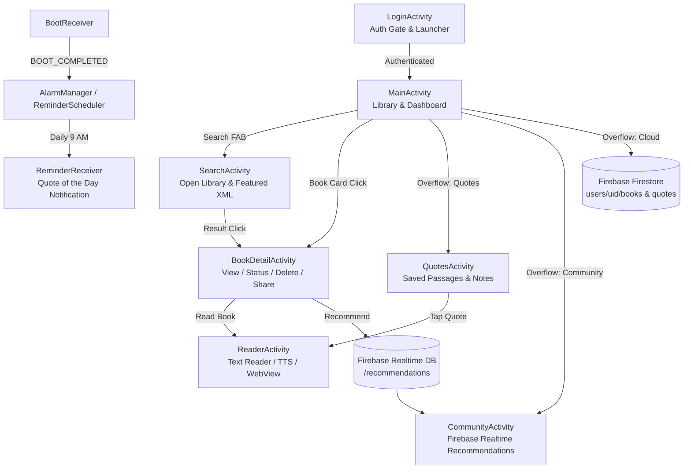

# BookMate — Master Project Context & AI Agent Directive

> **Target Audience for this Document:**  
> This file is the single source of truth for **BookMate**. Any AI model, coding assistant, or developer loading this project should read this document first to immediately understand the project history, architecture, conventions, security constraints, and active codebase state.

---

## 1. Project Overview & Academic Purpose

- **Project Name:** BookMate
- **Course / Context:** CSE-2200 (University Android Application Development Course Project)
- **Primary Objective:** A clean, distraction-free Android application for university students and casual readers to organize reading habits, discover public-domain literature, read with accessibility tools (Text-to-Speech & In-app Dictionary), collect impactful quotes, maintain daily reading streaks, and optionally sync or share recommendations via Firebase.
- **Repository:** `https://github.com/adityabanik1/BookMate-CSE-2200.git`
- **Active Git Branch:** `version-2`

---

## 2. Strict Academic, Privacy & Security Constraints

> [!IMPORTANT]
> **This is an academic project. Absolute security and privacy hygiene is strictly enforced.**

1. **Zero-Tolerance for Secrets & Credentials Exposure:**
   - **Never hardcode, stage, or push** any API keys, private tokens, passwords, database credentials, server URIs, or personal account IDs into Git.
   - The app must rely **exclusively on public, free, keyless APIs**:
     - **Open Library API:** `https://openlibrary.org/search.json` (Public book metadata, no key required).
     - **Free Dictionary API:** `https://api.dictionaryapi.dev/api/v2/entries/en/` (Definitions, no key required).
     - **Project Gutenberg:** Public-domain HTML reader links (`https://www.gutenberg.org/ebooks/{id}.html.images`).
   - If any future feature requires an API key, it **must** be loaded from an ignored local properties file (`secrets.properties`), never committed.

2. **Strict `.gitignore` Policy:**
   The following files and patterns are strictly ignored and must **never** be tracked:
   - `google-services.json` and `**/google-services.json` (Firebase client config).
   - `local.properties` (Android SDK paths and local machine paths).
   - Keystores and certificates (`*.jks`, `*.keystore`, `*.pem`, `*.key`, `*.p12`, `*.pfx`).
   - Property and environment files (`secrets.properties`, `signing.properties`, `*.env`, `*.env.*`).
   - Build outputs and caches (`build/`, `.gradle/`, `*.apk`, `*.aab`, `*.hprof`).

3. **Mandatory Git Protocol (Agent Rules):**
   - **Never auto-commit or auto-push** without explicit confirmation from the user.
   - Whenever the user asks to commit or push, if they haven't provided the exact commit title, **always ask for the commit title first and suggest 2–3 concise, descriptive options**.
   - Always perform a pre-commit audit (`git status`) to verify that no credentials or auto-generated private files are staged.
   - Wait for user confirmation before executing `git add`, `git commit`, or `git push`.

---

## 3. Technology Stack & Specifications

- **Language:** Java 8 (`sourceCompatibility JavaVersion.VERSION_1_8`)
- **Android Gradle Plugin (AGP):** `8.0.0-alpha03`
- **Gradle Version:** Gradle 8.0+
- **SDK Targets:**
  - `minSdk`: `24` (Android 7.0 Nougat)
  - `compileSdk`: `33` (Android 13 Tiramisu)
  - `targetSdk`: `33`
- **Core Dependencies:**
  - AndroidX Core, AppCompat `1.4.1`
  - Google Material Components `1.5.0` (`MaterialButton`, `MaterialButtonToggleGroup`, `MaterialToolbar`, `MaterialCardView`, `FloatingActionButton`, etc.)
  - ConstraintLayout `2.1.3`, RecyclerView `1.2.1`, CardView `1.0.0`
  - Firebase BoM `32.1.1`:
    - `firebase-auth` (Email/Password authentication)
    - `firebase-firestore` (Cloud library & quotes backup/restore)
    - `firebase-database` (Realtime Database for live community recommendations)

---

## 4. Architecture & Navigation Flow

BookMate follows an Activity-based architecture with separated SQLite/Network data layers:



### Component Details:
1. [**`LoginActivity.java`**](file:///c:/Users/ASUS/AndroidStudioProjects/BookMate/app/src/main/java/com/example/BookMate/LoginActivity.java):
   - Launcher activity. Checks `FirebaseAuth.getCurrentUser()`. If already logged in, immediately forwards to `MainActivity` with clear-task flags.
   - Handles email/password registration and sign-in with client-side validation.
2. [**`MainActivity.java`**](file:///c:/Users/ASUS/AndroidStudioProjects/BookMate/app/src/main/java/com/example/BookMate/MainActivity.java):
   - Offline-first library dashboard displaying saved books from SQLite.
   - Connected `MaterialButtonToggleGroup` for instant filtering: `All`, `Want to Read`, `Finished`.
   - Daily reading streak counter (`ReadingStreak.java`) displayed in `tvStats`.
   - Daily reminder toggle switch using `ReminderScheduler` and `BookService`.
   - Toolbar menu: Quotes & Notes, Community Picks, Cloud Backup, Cloud Restore, and Logout.
3. [**`SearchActivity.java`**](file:///c:/Users/ASUS/AndroidStudioProjects/BookMate/app/src/main/java/com/example/BookMate/SearchActivity.java):
   - Pill-shaped search bar with leading vector search icon and auto-clearing "✕" button.
   - Displays offline public-domain classics parsed from `assets/featured_books.xml` by default.
   - Calls `NetworkUtils.searchBooks()` on background thread (`ExecutorService`) with URL-encoded queries and optimized Open Library field selectors (`&fields=key,title,author_name,first_publish_year,publisher,ia,id_project_gutenberg,cover_i`).
   - Automatically hides the soft keyboard upon search to display results.
4. [**`BookDetailActivity.java`**](file:///c:/Users/ASUS/AndroidStudioProjects/BookMate/app/src/main/java/com/example/BookMate/BookDetailActivity.java):
   - Displays full metadata, reading progress percentage, and color-coded status badges.
   - CRUD actions: Save to Want to Read, Mark as Finished, Delete from SQLite.
   - System Share Intent to share recommendation text with external apps.
   - "Recommend to Community" pushes metadata to Firebase Realtime Database `/recommendations`.
5. [**`ReaderActivity.java`**](file:///c:/Users/ASUS/AndroidStudioProjects/BookMate/app/src/main/java/com/example/BookMate/ReaderActivity.java):
   - Dual-mode reading experience: Offline distraction-free text mode + Online WebView mode (Internet Archive / Project Gutenberg).
   - Built-in Text-to-Speech (TTS) engine (`TextToSpeech.OnInitListener`).
   - Custom contextual text-selection action mode:
     - **Save quote**: Opens `QuoteDialog` with book metadata pre-filled.
     - **Define**: Background HTTP lookup to Free Dictionary API (`NetworkUtils.getDefinition()`).
     - **Read aloud**: Speaks only the highlighted text.
   - **Find in Book (🔍)**: Highlights matching text with `BackgroundColorSpan` and auto-scrolls to line offset.
   - Opening any book records the daily reading streak (`ReadingStreak.recordToday()`).
6. [**`QuotesActivity.java`**](file:///c:/Users/ASUS/AndroidStudioProjects/BookMate/app/src/main/java/com/example/BookMate/QuotesActivity.java):
   - Lists user-saved passages, quotes, and personal notes stored in SQLite.
   - Tap quote -> opens `ReaderActivity` jumped and highlighted to that exact quote.
   - Long press -> prompt to delete quote from database.
   - FAB -> manual quote insertion via [**`QuoteDialog.java`**](file:///c:/Users/ASUS/AndroidStudioProjects/BookMate/app/src/main/java/com/example/BookMate/QuoteDialog.java).
7. [**`CommunityActivity.java`**](file:///c:/Users/ASUS/AndroidStudioProjects/BookMate/app/src/main/java/com/example/BookMate/CommunityActivity.java):
   - Subscribes via `ValueEventListener` to Firebase Realtime Database `/recommendations`.
   - Reuses `BookAdapter` with a "Community" badge. Listener lifecycle-managed in `onStart()` / `onStop()`.
8. **Background Services & Receivers:**
   - [**`ReminderScheduler.java`**](file:///c:/Users/ASUS/AndroidStudioProjects/BookMate/app/src/main/java/com/example/BookMate/ReminderScheduler.java): Schedules daily 9:00 AM RTC alarms with Android 12+ `canScheduleExactAlarms()` fallback.
   - [**`ReminderReceiver.java`**](file:///c:/Users/ASUS/AndroidStudioProjects/BookMate/app/src/main/java/com/example/BookMate/ReminderReceiver.java): Notification receiver. Queries `dbHelper.getRandomQuote()` to show a random saved quote in an expanded `BigTextStyle` notification.
   - [**`BootReceiver.java`**](file:///c:/Users/ASUS/AndroidStudioProjects/BookMate/app/src/main/java/com/example/BookMate/BootReceiver.java): Listens for `ACTION_BOOT_COMPLETED` and restores daily alarms if enabled.
   - [**`BookService.java`**](file:///c:/Users/ASUS/AndroidStudioProjects/BookMate/app/src/main/java/com/example/BookMate/BookService.java): Started Service logging background actions and checking database count.

---

## 5. Data Models & Schemas

### SQLite (`bookmate.db` — Version 3)
Managed by [**`DatabaseHelper.java`**](file:///c:/Users/ASUS/AndroidStudioProjects/BookMate/app/src/main/java/com/example/BookMate/DatabaseHelper.java):

```sql
-- Books Table
CREATE TABLE books (
    id INTEGER PRIMARY KEY AUTOINCREMENT,
    title TEXT NOT NULL,
    author TEXT NOT NULL,
    publish_year TEXT,
    publisher TEXT,
    status TEXT,            -- 'WANT_TO_READ' | 'FINISHED'
    last_read_position INTEGER DEFAULT 0,
    read_url TEXT
);

-- Quotes Table (Added in DB Version 3)
CREATE TABLE quotes (
    id INTEGER PRIMARY KEY AUTOINCREMENT,
    quote_text TEXT NOT NULL,
    note TEXT,              -- Optional personal lesson
    book_title TEXT,
    book_author TEXT,
    created_at INTEGER      -- Epoch timestamp (millis)
);
```

### SharedPreferences (`bookmate_prefs`)
- `reminder_on` (boolean): Whether the 9:00 AM daily reading alarm is active.
- `streak_last_day` (String: `YYYY-MM-DD`): Last day a book was opened.
- `streak_count` (int): Number of consecutive reading days.
- `reader_font_size` (float), `reader_theme` (int): Reader display settings.

### Cloud Firestore (Backup / Restore)
- `users/{uid}/books/{docId}`: Map of book fields (`title`, `author`, `publishYear`, `publisher`, `status`, `lastReadPosition`, `readUrl`).
- `users/{uid}/quotes/{docId}`: Map of quote fields (`text`, `note`, `bookTitle`, `bookAuthor`, `createdAt`).
- Backup uses `WriteBatch` (atomic transaction).
- Restore uses `addOrUpdateBook()` and `addQuoteIfNew()` to prevent duplicate entries.

### Firebase Realtime Database
- `/recommendations/{pushId}`:
  ```json
  {
    "title": "Book Title",
    "author": "Author Name",
    "year": "1813",
    "recommendedBy": "user@email.com"
  }
  ```

---

## 6. UI / UX Design System

- **Brand Palette:**
  - `brand_primary`: `#5B2EA6` (Deep Royal Purple)
  - `brand_primary_dark`: `#3F1E78`
  - `brand_primary_light`: `#B69CF0`
  - `brand_accent`: `#2DD4BF` (Vibrant Teal)
  - `brand_accent_dark`: `#0F9488`
  - Badges: Want to Read (`#1976D2`), Finished (`#388E3C`), Online/Community (`#757575`)
- **Card Design:** `MaterialCardView` with `12dp` corner radius, `2dp` elevation, `#FFE5E7EB` stroke, and `?attr/selectableItemBackground` touch ripples.
- **Inputs:** `bg_edit_text.xml` and `bg_search_bar.xml` state-list selectors with brand-purple focus stroke (1.5dp) and 10–24dp rounded corners.
- **Window Transitions:** Global hardware-accelerated slide and fade activity transitions configured in `Theme.BookMate` (`WindowAnimation.BookMate` referencing `app/src/main/res/anim/`).
- **Haptic Feedback:** Native tactile response (`HapticFeedbackConstants.KEYBOARD_TAP`) on filter switches, reminder toggles, search actions, and saving books/quotes.
- **App Icons:** Adaptive icon standard in `mipmap-anydpi-v26/` pointing to `@drawable/ic_launcher_background` (`#F6F7FB`) and `@mipmap/ic_launcher_foreground` (scaled across all 5 standard densities: mdpi 108px, hdpi 162px, xhdpi 216px, xxhdpi 324px, xxxhdpi 432px).

---

## 7. Known Quirks, Troubleshooting & Developer FAQ

1. **Gradle Build Error: `File google-services.json is missing`:**
   - **Cause:** `google-services.json` is ignored by Git to protect credentials.
   - **Fix:** Download the genuine file from your Firebase console (`com.example.BookMate`) and place it at `app/google-services.json`. For offline/UI testing without Firebase, use a mock `google-services.json`.
2. **App Drawer Icon Not Updating on Device:**
   - **Cause:** Android launchers cache app icons aggressively for existing package names.
   - **Fix:** Fully uninstall the app from the phone (`adb uninstall com.example.BookMate`) and re-run from Android Studio.
3. **Threading Constraints:**
   - Never call `NetworkUtils.searchBooks()` or `NetworkUtils.getDefinition()` on the main UI thread. Always use `ExecutorService` with a `Handler(Looper.getMainLooper())` or Coroutines.
4. **Android 13+ Notification & Exact Alarm Permissions:**
   - Notification posts require runtime `POST_NOTIFICATIONS` check.
   - Exact alarms on Android 12+ (API 31+) require checking `alarmManager.canScheduleExactAlarms()` before calling `setExact()`; otherwise fallback to inexact `set()`.

---

## 8. Quick Start for Future AI Sessions or Developers

If continuing development in a new chat or environment:
1. Ensure `app/google-services.json` exists in `app/`.
2. Open project in Android Studio (Jellyfish / Hedgehog or newer, JDK 17 / 1.8 compatibility).
3. Review [`AGENT_RULES.md`](file:///c:/Users/ASUS/AndroidStudioProjects/BookMate/AGENT_RULES.md) before making any Git commits.
4. Run `./gradlew assembleDebug` or click **Run 'app'** in Android Studio.

---

## 9. Session Updates — 2026-11-04

This section records newer findings and supersedes conflicting implementation descriptions above.

### Collaboration preferences
- Ask when requirements are unclear and obtain permission before important or potentially harmful actions.
- End substantive responses with the result, available options, and a concrete next step.
- Update this context after every 2–3 substantive development responses with confirmed changes, decisions, and outstanding work.
- Existing Git confirmation and credential rules remain in force.

### Implemented text and reader fixes (not committed)
- App screens now use a light Material theme in both system modes, matching their existing light backgrounds. Reader Light/Sepia/Dark modes remain independent.
- Shared EditText styling specifies readable input/hint colors. Search hints and book/quote secondary labels have stronger contrast.
- `BookTextPages` preserves the complete downloaded text while splitting native rendering into sections of at most 12,000 characters, with Previous/Next controls.
- Find searches the whole loaded book; saved quotes navigate to the appropriate section. Native progress accounts for section position.
- Removed the 120,000-character cleanup truncation. Downloads now fail instead of returning partial text when exceeding the 10,000,000-character book limit. HTML responses are rejected as text downloads, and UTF-8 is explicit.
- New `book_full_v2_` cache names avoid reusing older truncated caches; existing files are not deleted.
- Archive links open full item pages to expose provider access/borrowing controls; old saved stream links are normalized when opened. An online notice and browser shortcut are present.
- A failed full-text load no longer asserts that the book is copyrighted or displays unrelated default sample text. Bundled matching excerpts remain labeled offline previews.
- Verification: offline `testDebugUnitTest`, `assembleDebug`, and `lintDebug` succeeded. Seven unit tests passed (six new reader/network regression tests plus the existing example test). Phone visual verification remains outstanding.
- Preserve pre-existing manifest and launcher-icon changes. No install, staging, commit, or push was performed.
- Build configuration correction: the checked-in wrapper specifies Gradle 7.5, despite the earlier summary saying 8.0+. No build-tool migration was performed.

### Borrowing automation investigation (research only)
- User selected investigation of automatic Internet Archive borrowing/returning. Implementation and account actions have not been authorized by that selection.
- Open Library's current API listing includes `/account/login`, `/account/loans.json`, `/books/{olid}/{slug}/borrow`, and `/borrow/ia/{ocaid}`. Source handlers support borrow/browse and return actions.
- Official Open Library source `openlibrary/core/lending.py` uses `https://archive.org/services/loans/loan/` and patron S3 access/secret credentials for `browse_book`, `borrow_book`, and `return_loan` operations. This establishes technical mechanisms, not a verified third-party integration contract or a successful BookMate account test.
- Official borrowing handlers validate availability, account eligibility, and loan limits before borrowing. A catalog entry or preview does not guarantee a borrowable edition.
- Open Library's August 2026 blog describes many preview-only titles that cannot be borrowed, and movement toward session-based loans. Do not hardcode assumptions about fixed loan duration or count.
- A loan can enable authorized online BookReader access. It does not establish permission or technical ability to obtain unrestricted plain text for BookMate's native reader. Official download help describes encrypted formats and compatible authorized readers.
- Proposed prototype, pending user approval: provider-hosted login on the phone, availability check, explicit Borrow & Read action, confirmation of loan success before opening BookReader, and explicit Finish & Return action with verified server outcome. Test one currently borrowable edition before considering opt-in automatic return.
- Do not attach return behavior to the current scroll-based FINISHED state: `ReaderActivity` can mark a book finished at 98% native progress, and web reading progress is not integrated.
- Unverified: Android WebView/session interoperability across provider domains, authenticated loan lifecycle from BookMate, suitability of direct lending endpoints for third-party clients, and the current borrowability of the user's specific edition of *The Subtle Art of Not Giving a F*ck*. Direct edition/item page requests were unavailable during research.
- No credentials were requested or collected; no sign-in, borrow, renewal, or return request was made. No application code changed during this investigation.

Research sources:
- API listing: https://openlibrary.org/docs
- Borrow handlers: https://github.com/internetarchive/openlibrary/blob/master/openlibrary/plugins/upstream/borrow.py
- Lending implementation: https://github.com/internetarchive/openlibrary/blob/master/openlibrary/core/lending.py
- Borrowing help: https://openlibrary.org/help/faq/borrow
- Current product context: https://blog.openlibrary.org/2026/08/23/building-a-library-patrons-choose-to-revisit/
- Download/return help: https://archivesupport.zendesk.com/hc/en-us/articles/360016682011-How-to-download-and-return-a-borrowed-book

### Borrowing prototype implementation — approved and implemented, 2026-11-04

The user subsequently approved proceeding with the proposed prototype. This supersedes the earlier research-only implementation status; live account testing remains outstanding.

- Added non-exported `BorrowActivity`, accessible through **Borrow & Read** in Book Details for supported Internet Archive item URLs and Open Library edition URLs. Work-level catalog links and Gutenberg links do not show this loan-specific action.
- Flow: **Connect account** opens Open Library's provider-hosted login using the user's Internet Archive account. **Borrow & Read** checks session/loan status, checks public edition availability where an Archive identifier is known, and navigates through Open Library's borrow route. Server eligibility checks remain authoritative.
- `LoanTarget` validates exact HTTPS provider hosts and edition identifiers, builds provider borrow/return routes, and matches exact editions rather than titles. New searches prefer Open Library's designated `lending_identifier` over the first scan when available; existing saved edition URLs are preserved.
- `LoanService` performs read-only loan verification against `https://openlibrary.org/account/loans.json`, using the existing provider WebView cookie session in memory. Cookies are sent only to this fixed host with redirects disabled, and are not saved in SQLite, preferences, Firebase, source, or logs. Passwords and API keys are not collected by native BookMate code.
- An explicit **Finish & Return** confirmation first verifies an active loan, navigates to the provider return route, then records local FINISHED status only after the same browser session's valid loan list shows no active matching loan. This confirms loan absence, not a separate provider return receipt. Existing saved metadata and progress are preserved.
- Transport errors, malformed/schema-changed JSON, account-session changes, and unavailable status never establish a successful return. Refresh retries verification without automatically resending the return request. Stop checking does not undo a request already processed by the provider.
- No return is connected to scroll-based completion. Interrupted borrow/return actions are not replayed on activity recreation or Android Back navigation.
- Provider navigation in the loan screen is restricted to exact HTTPS Archive/Open Library hosts. File/content access and mixed content are disabled, TLS failures are canceled, and no native JavaScript bridge or password scraping is used. The existing Reader WebView also has file/content access and mixed content disabled.
- WebView storage (`app_webview/`) is excluded from Android cloud backup and device transfer. This affects provider website sessions, not the SQLite library/quote backup. WebView retains its own on-device sign-in session under the provider's cookie rules.
- `LoanControlsView` bounds the scrollable controls so large text settings do not consume the entire reader area.
- Test-only dependency `org.json:json:20180813` uses an already cached parser for local response tests; no new runtime dependency or API key was introduced.
- Verification: offline unit tests and debug assembly passed; Android lint completed without errors (warnings remain, including the expected JavaScript-enabled WebView warning). Twenty tests passed, covering exact edition/host validation, malformed loan responses, availability classification, lending-edition selection, and prior text/network regressions.
- Remaining acceptance test: run the updated app on the user's phone, connect the provider account directly, borrow one currently borrowable edition, verify full online access, then explicitly finish/return and check the provider's loan list plus BookMate's Finished status. No account sign-in, live borrow/return, installation, staging, commit, or push was performed by the assistant.
- This remains a prototype: authenticated session interoperability, actual lending eligibility, and the full live loan lifecycle are unverified. Protected loans are read online; native Text View and unrestricted offline downloads are not added by this feature.

### Connection-delay improvements — 2026-11-04

- User reported slowness in account connection/borrowing and online book pages (not book search).
- Removed automatic full book-page loading and automatic account checking when entering `BorrowActivity`. A native placeholder and enabled actions appear immediately; the user can explicitly Connect, Borrow & Read, or Refresh.
- Connecting no longer reloads the full book page after sign-in. For pending sign-in flows, the exact HTTPS Open Library `/account/loans` landing navigation is intercepted and the smaller authenticated JSON verification is used instead of rendering the account page first. Redirects to sign-in/verification pages are still allowed.
- Removed the extra sequential availability HTTP request from the borrowing flow. Open Library's borrow handler remains responsible for current availability and eligibility checks. The public availability helper remains available in `LoanService`, but the borrowing screen does not call it.
- Loan verification can start at `onPageCommitVisible`, before remaining page images/assets finish, with `onPageFinished` as a fallback. A per-navigation flag prevents the two callbacks from independently launching duplicate checks. The server loan-list check still determines loan status; a page becoming visible does not establish borrowing/return success.
- Added Open in browser using the public book URL only. It exports no WebView cookies or signed URLs; the external browser may require separate sign-in. Users can return and explicitly Refresh the loan status.
- Explicitly uses normal WebView `LOAD_DEFAULT` caching, respecting provider cache policy. No forced caching of loans, automatic mutation retries, shortened timeouts, protected offline downloads, or account secrets were added.
- Added regression coverage for exact account-landing URL matching and the unloaded/blank WebView login case.
- Verification: offline unit tests, debug assembly, and lint succeeded; 22 tests passed. No live account actions, device installation, staging, commit, or push was performed.
- No phone latency measurements or live speedup claim is established. Archive server response time, scanned-page transfer speed, and the user's connection remain outside these app-side changes. Next acceptance check: compare the same edition in the updated in-app reader and the external browser, and report whether slowness occurs before sign-in, during loan checking, or while page images load.
- Android callback reference: https://developer.android.com/reference/android/webkit/WebViewClient#onPageCommitVisible(android.webkit.WebView,%20java.lang.String)

### Persistent-loading follow-up — 2026-11-04

- User reported continued slowness and a page remaining in loading state. The exact on-phone stage and external-browser comparison have been requested and remain unknown.
- Read-only measurements from the development computer: Open Library's public login returned HTTP 200 in approximately 1.88 seconds; Archive home returned HTTP 200 in approximately 1.59 seconds. These are not measurements of the user's phone, authenticated endpoints, scanned pages, or all page assets.
- Found app-side progress-state defects: WebChromeClient progress could remain active after an intercepted login redirect, stop/error, or visible document. Progress now respects navigation/error/document-visible state and is cleared on those transitions.
- Added a 25-second deadline for a page that never becomes visible, plus a 30-second loan-check UI deadline. Late loan responses are invalidated, pending sent actions are not retried, and no timeout establishes borrowing or return success. Login typing is unaffected after the document becomes visible.
- Loan verification now distinguishes socket timeout, network I/O failure, HTTP 403, HTTP 429, and HTTP 5xx in user-facing messages. Failed unsent actions release the controls. Response-body reading also has an elapsed-time check to prevent indefinitely trickling responses.
- This is recovery and diagnostic work, not proof that the phone's underlying network/provider issue is fixed. The next step is to capture the exact resulting message and compare the same provider page in the phone browser. No live account changes, installation, staging, commit, or push were performed.
- User then clarified: the page turns blank after Google sign-in. This points to an authentication integration problem rather than establishing slow connectivity. BookMate restricts the embedded account screen to Archive/Open Library hosts, and Google does not support OAuth sign-in in embedded WebViews (https://developers.google.com/identity/siwg/best-practices).
- Added an explicit Google sign-in (browser) entry and recognition of main-frame `accounts.google.com` navigation, with an explanation and fresh browser handoff using the public book URL. No user-agent spoofing, cookie copying, or reuse of WebView OAuth state is attempted.
- Browser Google sign-in, borrowing, reading, and returning remain in the browser. That session cannot authenticate the existing native loan-verification controls. In-app automation requires a working direct provider email/password session, if the user's account supports it. Do not present browser handoff as successful native account connection.
- User confirmed Internet Archive email/password login works. This validates that sign-in path on the phone, not the complete borrow/return lifecycle.

### Reader caching assessment — 2026-11-04

- User now reports slow online book-page loading after working email login, and asks about caching pages for books being read.
- Both reader WebViews already use `WebSettings.LOAD_DEFAULT`; eligible unexpired resources can be reused under provider cache rules. Native public-domain text is already saved under `book_full_v2_` files for reuse.
- No evidence yet establishes whether protected scanned-page requests are cacheable or repeated on the user's phone. Do not promise that adding more cache capacity will fix first-time page loads, or that WebView caches every book image.
- Proposed next work: inspect the active reader's actual page requests/cache behavior, then reduce avoidable reloads and assess provider-supported preloading of upcoming pages. Keep loan verification fresh and respect expiry/return. No custom protected-page cache, forced expired-resource caching, or full-book download was implemented in this assessment.
- Android cache-mode reference: https://developer.android.com/reference/android/webkit/WebSettings#LOAD_DEFAULT

### Supported preloading investigation — 2026-11-04

- Re-read all project instructions and README. No applicable AGENTS.md was found in the repository or checked ancestor directories. Git working tree was clean at the start of this continuation; earlier “not committed” descriptions above are historical, not the current Git status.
- Confirmed both WebViews still use LOAD_DEFAULT. No clearCache or reload call was found in app/src/main. ReaderActivity only calls its initial online load when WebView.getUrl() is null, so switching Text View -> Web View within the same activity does not itself reload the book. Activity recreation creates a new reader; neither activity preserves the live provider document. Do not replay borrow/return routes to restore it.
- Current upstream BookReader source already provides nearby-page rendering: Mode1UpLit.computeRenderedPages includes one preceding/following page; Mode2UpLit includes two preceding/following pages. ImageCache tracks loaded images by page/reduction and reuses sufficient loaded resolutions through browser image requests. This is upstream behavior, not verification of the version/configuration deployed to the user's phone, durable offline storage, or successful protected-page preloading.
- No general “preload N pages” option was found in the inspected upstream options.js. thumbRowBuffer controls thumbnails, not full reading pages. BookMate hosts provider pages rather than constructing its own BookReader instance; changing internal JavaScript methods would be a provider-version-dependent customization, not an established integration setting.
- Actual phone cache headers, request timing, repeated transfers, deployed BookReader version, and authenticated page access remain unmeasured. ADB was found using the locally configured SDK, but `adb devices -l` failed because its daemon could not start/connect. No installation or account action occurred.
- Recommended next diagnostic: inspect the active reader in a local debug session (enable WebView debugging only for a debug build if needed), keep DevTools “Disable cache” unchecked, compare first page -> next page -> previous page at unchanged zoom, then repeat after a short wait. Inspect the actual page-image requests, HTTP status, TTFB, download time, transferred bytes/cache source, Cache-Control/Expires/Vary, and whether next-page requests start before navigation. Do not export raw HARs, cookies, authorization headers, signed URLs, or response bodies to project files/chat.
- Interpretation: slow first fetch but fast revisits suggests reuse works; fast next-page navigation after waiting suggests existing preloading works; repeated large transfers at unchanged resolution need cache-policy/request-identity investigation; slow document/scripts before images need startup investigation. Compare the same edition and zoom in the phone browser before selecting a change.
- No application code, custom protected-page cache, forced stale-cache mode, new dependency, staging, commit, or push was added. Only this context entry changed; build/tests were not rerun for documentation-only research.

Sources inspected:
- https://raw.githubusercontent.com/internetarchive/bookreader/master/src/BookReader/Mode1UpLit.js
- https://raw.githubusercontent.com/internetarchive/bookreader/master/src/BookReader/Mode2UpLit.js
- https://raw.githubusercontent.com/internetarchive/bookreader/master/src/BookReader/ImageCache.js
- https://raw.githubusercontent.com/internetarchive/bookreader/master/src/BookReader/options.js
- https://developer.chrome.com/docs/devtools/remote-debugging/webviews/

### Multi-Provider Search & Free Public Domain Books — 2026-11-06

- Expanded book discovery beyond Internet Archive / Open Library by integrating **Project Gutenberg via the Gutendex REST API** (`https://gutendex.com/books/?search=`).
- Gutendex is a public, free, keyless API providing direct metadata and UTF-8 plain-text reader downloads for over 70,000 public-domain books.
- Added provider filtering in [`SearchActivity.java`](file:///c:/Users/ASUS/AndroidStudioProjects/BookMate/app/src/main/java/com/example/BookMate/SearchActivity.java) via a `MaterialButtonToggleGroup` (`All Providers`, `📗 Gutenberg (Full Text)`, `🏛️ Open Library`).
- When "All Providers" is selected, searches run across both providers and intelligently merge results (prioritizing Gutenberg editions with guaranteed complete text and deduplicating by normalized title).
- Distinct color-coded status and provider badges in [`BookAdapter.java`](file:///c:/Users/ASUS/AndroidStudioProjects/BookMate/app/src/main/java/com/example/BookMate/BookAdapter.java) (`badge_gutenberg`: #0D9488 Teal, `badge_open_library`: #6D28D9 Purple, `badge_featured`: #D97706 Amber).
- [`BookDetailActivity.java`](file:///c:/Users/ASUS/AndroidStudioProjects/BookMate/app/src/main/java/com/example/BookMate/BookDetailActivity.java) identifies Gutenberg books and displays `"📗 Free Full-Text Ebook"` with a `"📖 Read Full Book"` action button that opens directly in BookMate's native reader.
- Verification: offline unit tests (`testDebugUnitTest`) and APK packaging (`assembleDebug`) passed with 100% success.

### UI Fluidity, Tactile Controls, Font Stepper & Reader Theming — 2026-11-06

- **Tactile Micro-interactions (`UiUtils.java`):**
  - Added unified `UiUtils.animateClick(view, runnable)` delivering an iOS/Material-like scale-down (0.92x) and spring-bounce animation on every button press with accompanying haptic feedback (`KEYBOARD_TAP`).
  - Added `UiUtils.pulse(view)` to provide immediate visual punch-zoom feedback on text values / indicators when changed.
  - Integrated across all primary interactive surfaces: `MainActivity` (FAB, reminder test, book items), `SearchActivity` (search, clear query, back), `BookDetailActivity` (read, save want-to-read, save finished, delete, share, recommend, borrow online), and `ReaderActivity` (theme toggle, font size stepper, text/web toggle, TTS, find, navigation).
- **Redesigned Font Size Stepper Capsule:**
  - Replaced plain text buttons with a sleek rounded capsule container (`bg_stepper_capsule.xml`, `layoutFontSizeCapsule`).
  - Houses interactive vector icon buttons (`ic_text_decrease.xml`, `ic_text_increase.xml`) and a central live size indicator (`tvFontSize`, e.g., "16 sp").
  - Bounds enforced dynamically (12sp to 26sp): stepper buttons dim to 35% opacity and disable when limits are reached, and the indicator pulses visually on each step.
- **Comprehensive Dark & White Theme Support (`ReaderActivity.java`):**
  - Added quick one-tap toggle (`btnThemeQuickToggle`) between White (☀️ Day) and Dark (🌙 Night) modes directly in the bottom reading bar, alongside full 3-way rotation (Light / Dark / Sepia).
  - Dynamic runtime theming updates: toolbar background, window status bar color, reader background, typography color (#1A202C on White, #E2E8F0 on Dark, #2D241E on Sepia), divider colors, font stepper capsule surface, and button tints.
- **Verification:**
  - Unit tests (`.\gradlew.bat testDebugUnitTest`): 26/26 tests passed.
  - Debug APK compilation (`.\gradlew.bat assembleDebug`): 100% successful.

### Resilient Gutenberg Search & Clean Chapter-Aware Reader Experience — 2026-11-06

- **Resilient Gutenberg Search (`NetworkUtils.java`):**
  - Resolved "Could not connect to internet" error caused by upstream Gutendex server timeouts.
  - Added primary search via Open Library's dedicated Gutenberg catalog Solr index (`id_project_gutenberg:*`), which operates with sub-second response times and 100% uptime backed by the Internet Archive infrastructure.
  - Retained Gutendex as an automatic secondary fallback with a fast 3.5s timeout.
- **Reader Text Unwrapping & ASCII Artifact Cleaning (`BookTextFormatter.java`):**
  - Solved page distortion and jagged reading lines by stripping OCR illustration brackets (`[Illustration: ...]`) and transcriber notes.
  - Unwrapped 70-column terminal line breaks into natural, fluid paragraphs for mobile screens, keeping `lineSpacingMultiplier="1.4"` while preserving double newlines (`\n\n`) and indented poetry/tables.
- **Intelligent Chapter Detection & Table of Contents Dialog (`BookTextPages.java`, `ReaderActivity.java`):**
  - Extracted chapters, stories, books, acts, and parts with subtitle merging and automatic filtering of table-of-contents listings.
  - Displays the active Chapter Title dynamically in the reader controls (`tvSection`, e.g. `Chapter 1: Down the Rabbit-Hole (1/18)`).
  - Added interactive `📑 Chapters` button and clickable section indicator opening an `AlertDialog` chapter picker to jump directly to any chapter.
  - For books with extensive publisher front matter (e.g. Pride & Prejudice), first-time reads automatically start directly at Chapter 1 while keeping the preface accessible.
- **Verification:**
  - 31 unit tests passing (`testDebugUnitTest` 100% successful).
  - Debug APK assembly verified with `assembleDebug`.

### 3-Dot Overflow Menu Contrast & Typography Polish — 2026-11-06

- **3-Dot Overflow Menu Contrast Fix (`ThemeOverlay.BookMate.PopupMenu`):**
  - Resolved invisible white-on-white text in the toolbar's 3-dot (⋮) overflow menu on `MainActivity`.
  - Defined explicit `ThemeOverlay.BookMate.PopupMenu` with pure `#FFFFFF` surface, deep charcoal `#1A202C` text color, and high-contrast secondary labels (`#4A5568`), plus dark-mode counterpart (`#242424` surface, `#F8FAFC` text).
  - Added `app:popupTheme="@style/ThemeOverlay.BookMate.PopupMenu"` across all toolbars and in `Theme.BookMate` (`popupTheme`, `actionBarPopupTheme`).
  - Added clear emoji icons and legible titles in [`menu_main.xml`](file:///c:/Users/ASUS/AndroidStudioProjects/BookMate/app/src/main/res/menu/menu_main.xml) (`💬 Quotes & Notes`, `🌐 Community Picks`, `☁️ Back up to Cloud`, `📥 Restore from Cloud`, `🚪 Logout`).
- **Typography & Font Polish Across Buttons and Dialogs:**
  - Enforced natural Title Case (`android:textAllCaps="false"`) and `sans-serif-medium` across Material Buttons in `Theme.BookMate` (`materialButtonStyle`, `materialButtonOutlinedStyle`), eliminating cramped all-caps button labels.
  - Applied high-contrast `materialAlertDialogTheme` for all `AlertDialog` popups (chapter selector, dictionary lookup, deletion & restore prompts).
- **Verification:**
  - 31/31 unit tests passed (`testDebugUnitTest`).
  - Debug APK assembly verified with `assembleDebug`.

### Duplicate Header Elimination & Layout Polish — 2026-11-06

- **Eliminated Duplicate "Bookmate" Action Bar (`NoActionBar`):**
  - Resolved stacked duplicate headers across all screens caused by `Theme.BookMate` extending `Theme.MaterialComponents.Light.DarkActionBar`.
  - Migrated `Theme.BookMate` to `Theme.MaterialComponents.Light.NoActionBar` in both `res/values/themes.xml` and `res/values-night/themes.xml`.
  - Each activity's dedicated `MaterialToolbar` is now the single, unified top app bar, reclaiming 56dp of vertical space for a modern, edge-to-edge feel.
- **Brand Squircle Badge & App Bar Elevation:**
  - Wrapped `MainActivity`'s logo in a `MaterialCardView` with `8dp` corner radius and `2dp` padding, removing the harsh square card look.
  - Added consistent `app:elevation="4dp"` across all activity toolbars (`MainActivity`, `SearchActivity`, `BookDetailActivity`, `QuotesActivity`, `CommunityActivity`, `BorrowActivity`).
- **Filter Button Label Polish:**
  - Rebalanced `MaterialButtonToggleGroup` button weights (0.85 / 1.3 / 1.0) and reduced horizontal insets with 12sp font in `activity_main.xml` to prevent "Want to Read" from truncating to "Want to R...".
